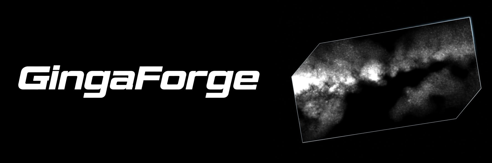
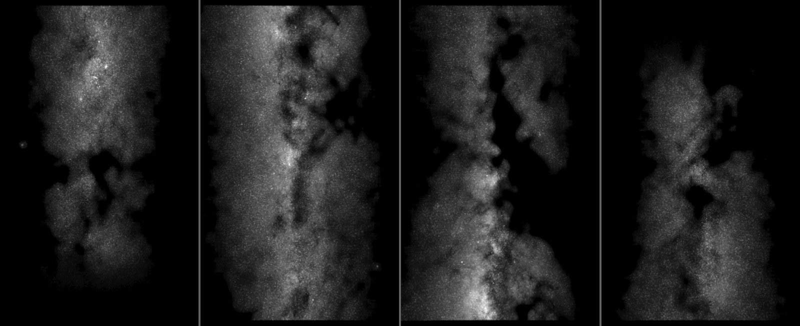
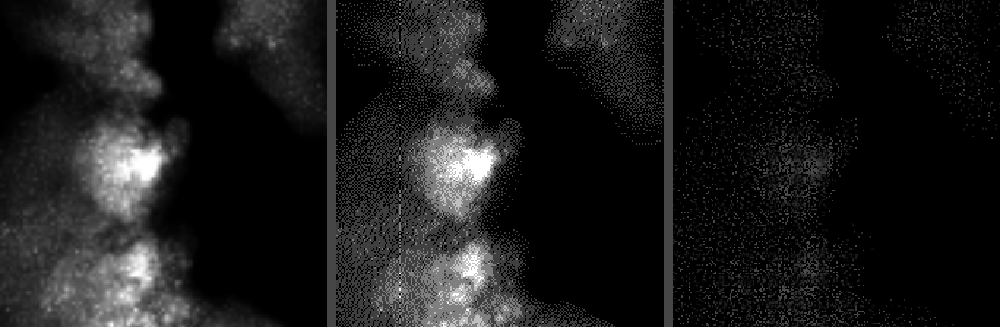
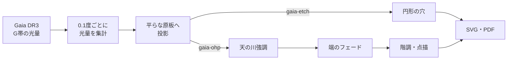

<p align="center">
  
</p>

<p align="center">
  <strong>Gaiaの観測データから、プラネタリウムの天の川原盤をつくる。</strong><br>
  Generate Milky Way projection plates for planetarium projectors from Gaia DR3.
</p>

<p align="center">
  <a href="pyproject.toml"></a>
  <a href="LICENSE"></a>
  <a href="NOTICE"></a>
  <a href="https://www.cosmos.esa.int/web/gaia/dr3"></a>
</p>

<p align="center">
  <a href="#クイックスタート">クイックスタート</a> ·
  <a href="#2つの方式">2つの方式</a> ·
  <a href="#仕組み">仕組み</a> ·
  <a href="#ドキュメント">ドキュメント</a> ·
  <a href="#ライセンス">ライセンス</a>
</p>

---

**GingaForge** は、銀河投影機（ぎんとう）用の天の川原盤を生成するPythonライブラリです。
Gaia DR3の星の光を空の区画ごとに合計し、金属エッチングやOHPフィルム印刷でそのまま使えるSVG・PDFにします。



<p align="center"><sub><code>gaia-ohp</code> の設定に全原盤を選んで生成した原盤（階調）。左から S1・S0・N0・N1 の順に、銀経320度から120度までの160度分を担当します。S1の下端とN1の上端が端のフェードです。プレビューは見やすいように暗い部分を明るくしています。</sub></p>

## 特徴

- **観測データそのまま**: 星を間引かず、`7.5 < G <= 17` の全天体の光量を合計します。暗黒帯も残ります。
- **実際の光学系に合わせた形**: ドーム半径・投影機の位置・レンズの焦点距離から、平らな原板上の位置を計算します。
- **2種類の製版**: 金属エッチング用の穴と、OHPフィルム印刷用の階調・点描に対応します。
- **天の川強調**: 背景に相当する明るさを差し引き、ドームで天の川が際立つようにします（OHP用）。
- **端のフェード**: 担当領域の両端の銀経320度と120度へ向けてなめらかに暗くし、端で光量を0にします（OHP用）。
- **1枚で比較**: 列ごとに設定を変えて並べ、1回のテスト印刷で描き方や明るさを比べられます。行を増やすと同じ原盤を1枚の用紙にコピーできます。

## クイックスタート

Python 3.11以上を使います。このフォルダだけで実行できます。

```sh
# 1. インストール
python3 -m venv .venv
.venv/bin/python -m pip install -e '.[test]'

# 2. 原盤の生成（初回は Gaia の光量も取得する）
.venv/bin/gingaforge gaia-etch --download-gaia
.venv/bin/gingaforge gaia-ohp
```

生成物は `output/<設定ファイル名>/` に保存されます。

> [!IMPORTANT]
> PDFは **倍率100%・「用紙に合わせる」なし** で印刷してください。原盤の寸法が変わると、ドームに正しく投影できません。

## 2つの方式

| | `gaia-etch` | `gaia-ohp` |
|---|---|---|
| **用途** | 金属エッチング | OHPフィルム印刷 |
| **描き方** | 円形の穴 | 階調・点描の画像（穴も選択可） |
| **天の川強調**（同梱設定） | なし | あり |
| **端のフェード**（同梱設定） | なし | あり（15度） |
| **設定ファイル** | [`gaia-etch.properties`](gaia-etch.properties) | [`gaia-ohp.properties`](gaia-ohp.properties) |
| **出力形式** | SVG・PDF | SVG・PDF |

`gaia-ohp` の描き方は `galaxy.ohp.render` で切り替えます。



<p align="center"><sub>左から <code>gray</code>（階調）・<code>dither</code>（点描）・<code>holes</code>（穴）。<code>holes</code> は光量倍率を下げて描いた比較用です。</sub></p>

| `render` | 描き方 | 向いている用途 |
|---|---|---|
| `gray` | 開口率の8ビット階調画像 | OHP印刷（インクジェット向き） |
| `dither` | 誤差拡散した点の画像 | OHP印刷（レーザー向き） |
| `holes` | 円形の穴 | 金属エッチング |

## 仕組み



銀緯±20度の範囲を、4枚の円形原盤に分けて担当します。銀経120度以上320度未満は対象外です。

| 原盤 | 銀経の範囲 | 原盤 | 銀経の範囲 |
|---|---|---|---|
| S1 | 320度以上360度未満 | N0 | 40度以上80度未満 |
| S0 | 0度以上40度未満 | N1 | 80度以上120度未満 |

作る原盤と、用紙に上から並べる順は設定ファイルの `plate.select` で決めます（同梱の `gaia-ohp` は `N1, N0, S0`）。

恒星原盤は別プロジェクトの[OTL](https://github.com/asanumakottii-collab/Orb-Transform-Library)が担当します。

## 使い方

寸法・明るさ・描き方などの設定は、同名の `.properties` ファイルで変えます。

| オプション | 内容 |
|---|---|
| `-f <設定ファイル>` | 別の設定ファイルを使う |
| `-svg` / `-pdf` | SVGのみ / PDFのみ出力 |
| `-mirrored` | SVG・PDFを出力し、PDFの2ページ目に裏面印刷用の左右反転を追加 |
| `--download-gaia` | Gaiaの光量を取得し直してから生成 |

テストは次のコマンドで実行します。

```sh
.venv/bin/python -m unittest discover -v
```

## ドキュメント

- [全体の構成](docs/overview.md) — 担当領域、出力先、コードの構成
- [Gaia方式](docs/gaia.md) — 投影・天の川強調・端のフェード・描き方・用紙の配置の仕組みと、すべての設定

## ライセンス

| 対象 | ライセンス |
|---|---|
| コード | [GPL-2.0-or-later](LICENSE) |
| Gaiaデータと、そこから生成した原盤（`output/`）・プレビュー画像 | [CC BY-NC 3.0 IGO](https://www.cosmos.esa.int/web/gaia-users/license)（クレジット: `ESA/Gaia/DPAC`） |

コードの一部は[OTL](https://github.com/asanumakottii-collab/Orb-Transform-Library)から移行して変更したものです。条件の詳細は[NOTICE](NOTICE)を参照してください。

Copyright (C) 2007, 2012–2014, 2026 東京大学地文研究会天文部
