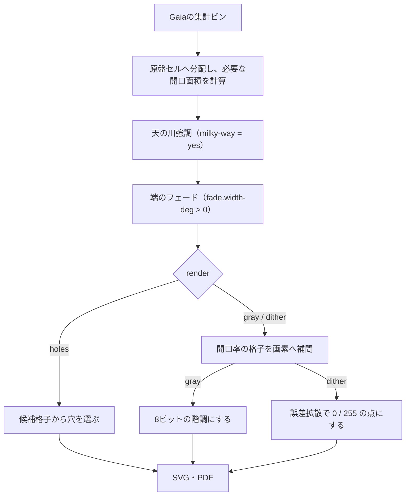

# Gaia方式（gaia-etch・gaia-ohp）

Gaia DR3のG帯の観測光量を、原盤上の開口面積に変換します。開口は円形の穴、またはOHP印刷用の階調・点描の画像で描きます。

- `gaia-etch.properties`: 金属エッチング用（円形の穴）
- `gaia-ohp.properties`: OHPフィルム印刷用（階調の画像、天の川強調あり）

担当領域（N0・N1・S0・S1）、用語、出力先の決まりは [overview.md](overview.md) を参照してください。

## 処理の順序



この文書は上の順に説明します。

- [使うデータ](#使うデータ) → [投影](#投影) → [セルへの集計](#セルへの集計) → [天の川強調](#天の川強調) → [端のフェード](#端のフェード) → [描き方](#描き方render)
- 描き方の中心は [`gray`](#render--gray) と [`dither`](#render--dither) の手順です。

## 使うデータ

**Gaia DR3のG帯の観測光量だけ**を使います。Hipparcos・Tycho・RC3を重ねず、
V等級への変換や星間減光の除去もしません。暗黒帯の効果を残した、地球から見える恒星光を扱います。
Gaiaの混雑領域での欠測や限界等級より暗い恒星、散光星雲の光は補完しません。
これはG帯に基づく投影原稿で、肉眼の暗所視や写真の完全な再現ではありません。

G等級の境界は、恒星投影機のV等級の境界と同一ではありません。
恒星投影機と同時に使う際は、色による違いも含めて重複・明るさを確認してください。

### 光量の取得（`--download-gaia`）

- ESA Gaia Archiveに非同期ADQLクエリを送り、4領域それぞれの `7.5 < G <= 17` の天体を銀経・銀緯0.1度のセルへ集計します。
- 星をランダムに間引かず、各セルで `SUM(10**(-0.4*(G - reference_magnitude)))` と天体数を取得します。
  個々の星はダウンロードしません。
- 取得には時間がかかる場合があり、ジョブURLと状態を表示します。結果の上限超過（OVERFLOW）は拒否します。
- 途中で失敗した場合、同じコマンドを再実行すると、検証済みの領域ファイルは再利用します。
- 取得結果は `galaxy.gaia.input`（既定 `source/gaia`、gitの対象外）に、クエリ・等級・領域・集計幅・チェックサムとともに保存します。
  通常の実行では通信せず、検証して読み込みます。
- 等級範囲・集計幅（`galaxy.gaia.*`）を変えた場合は `--download-gaia` で取得し直してください。加工条件だけの変更なら不要です。

## 投影

各原盤では、中心銀経・銀緯0度への光線を原盤中央に合わせ、レンズ中心を通る光線が平らな原板に当たる位置を求めます（OTLの恒星原板と同じ形）。

- 投影機の位置は `(0, ±projector-horizontal, ±projector-vertical)`（赤道座標での距離）です。
  横成分の符号は原盤番号0で正、1で負、縦成分はNで正、Sで負です。
- 座標変換の回転行列はHipparcosのICRS定義に基づきます（[ERFAの参照実装](https://github.com/liberfa/erfa/blob/master/src/icrs2g.c)）。
- 原盤の大きさは、OTLと同じくレンズの焦点距離から決めます。原板は投影機中心から `plate-distance`（P）の位置にあり、
  原板とレンズの距離 L は、レンズの公式 `1/f = 1/L + 1/(D − P − L)`（f は `focal-length`、D は投影機中心から原盤中心の方向のドームまでの距離）の小さい方の解です。
  光線はレンズ中心（投影機中心から P + L の位置）を通り、原盤中心の方向に垂直な平らな原板に当たります。
  原盤上の位置は、レンズ中心から見た光線の傾きの tan に比例します（`x = L × 銀北極方向の成分 / 原盤中心方向の成分` など）。
- `scale` はOTLと同じく長さの設定すべて（ドーム・投影機・原板・焦点距離）に掛かり、全体の相似縮小になります。
- 平らな原板では、銀緯±20度の境界は直線ではなく、原盤の両端ほど外側に広がる曲線になります。
- 空の同じ広さが、原盤の端ほど広い面積に写ります（四隅で中央の約1.5倍）。光量は空の集計ビンが写る範囲に分配するので、
  ドームでの明るさは保たれ、端では開口がまばらになります。レンズの周辺減光と歪曲は補正していません。

同梱の設定（R = 6500、`scale` = 1、中心配置）では、原盤上の範囲は次のとおりです。

| | `gaia-etch`（f = 19、P = 50） | `gaia-ohp`（f = 30、P = 400） |
|---|---:|---:|
| 原板とレンズの距離 L | 約19.06 mm | 約30.15 mm |
| 縦（銀経40度） | 約14.0 mm | 約23.6 mm |
| 横（銀緯±20度）の中央 | 約14.0 mm | 約23.6 mm |
| 横（銀緯±20度）の両端 | 約14.9 mm | 約25.2 mm |
| 対角線 | 約20.5 mm | 約34.6 mm |
| 原盤の中央で銀経1度の長さ | 約0.34 mm | 約0.56 mm |

## セルへの集計

穴でも画像でも、最初に原盤を `cell-size-mm` のセルに分け、各セルで必要な開口面積を求めます。
`render` に関係なく、4原盤すべてを集計します（`plate.select` で選ばなかった原盤も含む）。

```
必要な開口面積 = π × star-radius-7.5² × flux-gain × 相対光量 × 重なりの割合
```

- 相対光量は集計ビンの `SUM(10**(-0.4*(G - reference_magnitude)))` です。基準等級の星1個が1にあたります。
- 集計ビンの光量は、その像と原盤セルが重なる面積に比例して分配します。
  集計ビンの中心1点に置くと、原盤セル1つに入る集計ビンの数が4個と5個のように変わり、一様な空にも縞（モアレ）が出るためです。
- 集計ビンの像は長方形で近似します。レンズ中心がドーム中心にあれば厳密で、
  レンズ中心はドーム中心から plate-distance と原板・レンズ間の距離の分だけずれます（同梱の設定では `gaia-etch` で約69 mm、`gaia-ohp` で約430 mm）。

## 天の川強調

`milky-way = yes` のときだけ実行します（同梱の設定では `gaia-ohp`）。

G帯の光量をそのまま開口面積にすると、銀河面に集中しない7.5〜12等程度の前景星が光量の大半を占め、
天の川の中心（|b| = 2〜5°）と外側（|b| = 15〜20°）の明るさの比は約2.7倍しかありません（`source/gaia/` の集計値）。
実際の空では一様な夜光より暗い成分は背景に埋もれますが、ドームには夜光がないため、
この成分が「天の川の外側の明るさ」としてそのまま見えます。そこで背景に相当する一様な明るさを差し引き、天の川だけを残します。

1. 各セルの光量を、そのセルが天球上で占める立体角で割って表面輝度にします（偏心投影機にも対応）。
2. 原盤ごとに `smoothing-mm` 四方の中央値で平滑化し、明るさ S とします。中央値なので孤立した明るい星に引っ張られません。
3. 4原盤すべてのセルの S について、`black-percentile` の値を黒点 B、`anchor-percentile` の値を基準点 M とします（原盤ごとの自動露出はしません）。
4. `T(S) = M × max(0, (S − B) / (M − B))^gamma` とし、各セルの光量に `T(S) / S` を掛けます。

- 倍率は平滑化した明るさから決め、元のセル光量に掛けるため、天の川内部の暗黒帯や星団などの細部は残ります。
- S が黒点以下のセルは、明るい星も含めて開口面積が0になります。黒点を上げると外側が暗く天の川が細くなり、下げると外側の光が戻ります。
- `flux-gain` は強調の倍率を変えません。強調後の開口面積が `flux-gain` に比例します。
- 黒点・基準点は選ばなかった原盤も含めて計算するため、`plate.select` で明るさは変わりません。
- 強調後の開口面積はG帯光量に比例しない表示用の階調です。実行時に黒点・基準点（基準等級の星の個数/平方度）と遮光したセル数を表示します。
  同梱の `gaia-ohp.properties` では黒点11.6、基準点35.5で、732,028セルのうち292,815セルを遮光します。

## 端のフェード

`fade.width-deg` が0より大きいときだけ実行します（同梱の設定では `gaia-ohp` の15度）。

担当領域の両端の銀経320度と120度で光量を0にし、そこから銀経で `fade.width-deg` 離れた所までを暗くします。原盤の端で天の川が切れて見えないようにするためです。

各セルの中心の銀経について、320度・120度の近い方までの距離を d、`fade.width-deg` を w として、t = d / w（1以上は1）から次の倍率を開口面積に掛けます。

```
倍率 = (3t² − 2t³)³
```

- `3t² − 2t³`（smoothstep）は両端の傾きが0で、フェードの始まりと終わりに境目が見えません。
- 見た目の明るさは光量のほぼ3乗根に比例する（CIE明度 L*、暗所のスティーブンスのべき法則）ので、全体を3乗します。
  光量ではなく見た目の明るさが smoothstep で変わり、フェードの中央で見た目が半分（光量は1/8）になります。
  光量を直線で下げると、0の直前まで明るく見えて、端が切れたように見えます。
- 倍率は銀経だけで決まり、銀緯によりません。
- 天の川強調の後に掛けるので、黒点・基準点は変わりません。フェードの外側の開口面積も変わりません。
- `gray` では8ビットに丸めるため、同梱の設定では320度・120度から少なくとも約3度の範囲の画素がちょうど0になります（暗い場所ではもっと広くなります）。
- 暗くなるのは S1 の320〜335度と N1 の105〜120度です（同梱の設定）。S0・N0 と、原盤どうしの境目は変わりません。
- 同梱の設定（`gaia-ohp` は N1・N0・S0、`gaia-etch` は N1・N0）で出力に現れるのは120度の側だけです。320度の側は S1 を選ぶと現れます。

## 描き方（render）

`render` で、開口を何で描くかを選びます。ここまでの処理は共通です。

| render | 描き方 | 向いている用途 |
|---|---|---|
| `gray` | 開口率の8ビット階調画像。網点化はプリンターに任せる | OHP印刷（インクジェット向き） |
| `dither` | 開口率を誤差拡散した点の画像。点1個がプリンターの1画素以上 | OHP印刷（レーザー向き） |
| `holes` | 円形の穴 | 金属エッチング（gaia-etch） |

### OHP印刷で穴を使わない理由

OHP用に穴を描くと、直径0.02 mm・ピッチ0.04 mm（`scale = 1`）で、レーザープリンターの1画素（1200 dpiで約21 µm、600 dpiで約42 µm）以下の大きさになります。
プリンターは穴を1画素以上に太らせるか消し、密な所では隣の穴とつながるため、「穴面積∝光量」が印刷で保たれません。
円の数も多くなり（以前の同梱設定では3列で約87万個、PDF 54 MB・SVG 87 MB）、プリンターの処理も重くなります。
例えば `focal-length` 19・`holes`・セル0.2 mm・`flux-gain` 0.05 の N0 を Ghostscript で1200 dpiの白黒に描いたところ、開口面積は設計（5.7 mm²）の約4.9倍になりました
（同じ方法で、`dither` は設計どおり、`gray` は0.98倍。穴の直径が約7.3 µm だった以前の設定（`scale` 0.3667）では約13倍）。
また、候補をすべて開けても開口率は19.6%（π/4 × (穴径/ピッチ)²）までです。

一方、Gaiaの集計ビン0.1度は `gaia-ohp` の原盤の中央で約56 µm（約450 dpi）で、1200 dpiのプリンターの画素の2〜3倍の大きさです（同梱の `cell-size-mm` 0.056 はこの大きさに合わせています）。
そこで開口率を、プリンターの画素に合わせた画像として描きます。開口率は100%まで使えます。

### 画像の作り方（gray・dither共通）

`EtchingBuilder.build_raster` が、原盤ごとに次の順で開口率の画像を作ります。`gray` と `dither` の違いは手順5だけです。

**1. セルの開口率を求める**

```
開口率 = min(1, 必要な開口面積 / セルの面積)
```

- セル幅は `cell-size-mm × scale` です。画像には穴の候補格子がないため、`holes` のように切り下げません。
- 1を超える分は切り捨て、容量不足として実行時に表示します。隣のセルへ光を移すことはしません。

同梱の設定では、基準等級（G = 7.5）の星1個の必要な開口面積は `π × 0.038² × 0.4 ≈ 0.00181 mm²` です。
セルの面積は約0.00314 mm²なので、この光が1セルに集まると、強調前の開口率は約58%です。

**2. 画像の範囲を決める**

光のあるセルを囲む長方形を、四辺で半セルずつ広げて画像の範囲にします。1画素の大きさは `25.4 / raster-dpi` mm で、
画素の数は範囲の大きさから切り上げます。半セル広げるのは、手順3の補間で光がセルの外へ半セル分広がるためです。

同梱の設定では、1画素が約21.2 µm、セル幅が約2.6画素で、N0・N1の画像は1199 × 1125画素（約25.4 × 23.8 mm）です。

**3. 画素へ補間する**

各画素の中心の開口率を、周りの4つのセル中心の値から双線形補間します。セルの正方形の段差がなめらかにつながります。

補間で1つのセルの値が届く範囲は、セル2個分の幅の山になります。山の体積は `開口率 × セルの面積` に等しいため、
補間の前後で開口面積の合計はほとんど変わりません（同梱の N1 で 10.26 mm² → 10.25 mm²）。

**4. 枠の外を消す**

画素の中心が枠の円の外にある画素を0にします。同梱の `gaia-ohp` は枠の直径が50 mm、原盤の対角線が約34.6 mmのため、光のある範囲は切れません。

**5. 画素の値にする**

`render` に応じて、次の [`gray`](#render--gray) または [`dither`](#render--dither) の手順で0〜255の値にします。255が光を通します。

### render = gray

開口率をそのまま8ビットの階調にします（`gray_pixels`）。

```
画素の値 = round(255 × 開口率)
```

1. 画素ごとに独立に計算します。隣の画素の値には影響されません。
2. 階調の幅は1/255（約0.39%）です。開口率が約0.2%未満の画素は0になります。
3. 画像に変換した後の網点化はプリンターが行います。実際の開口面積は、プリンターの網点と階調特性で決まります。

同梱の設定では、暗い階調をよく使います。光のある画素の値の中央値は N0 で12（約5%）、N1 で10（約4%）で、
N0 の約39%、N1 の約50%の画素は値が10未満（約4%未満）です。
プリンターの暗い階調の出方が、天の川の外縁の明るさを大きく左右します。

### render = dither

開口率を、光を通す（255）か通さない（0）かの2値の点にします（`dither_pixels`）。
点の密度が開口率を表します。乱数は使わないため、同じ入力と設定からは同じ画像ができます。

8ビットに丸めると暗い部分の階調が粗くなるため、手順3の開口率を浮動小数点のまま扱います。

1. 上の行から順に処理します。各行の進む向きは交互で、1行目は左から右、2行目は右から左です（蛇行順）。
   同じ向きだけで処理すると、誤差が一方へ流れて模様が出やすくなるためです。
2. 画素の現在の値 v（開口率に、受け取った誤差を足したもの）を0.5と比べます。

   | v | 結果 | 残す誤差 |
   |---|---|---|
   | 0.5以上 | 点を打つ（255） | v − 1 |
   | 0.5未満 | 点を打たない（0） | v |

3. 残した誤差を、まだ処理していない隣の画素へ Floyd–Steinberg の重みで配ります。

   ```
             [処理中]   7
          3     5       1
   ```

   図は左から右へ進む行の場合です。右から左へ進む行では左右が逆になります。重みの合計は16です。
4. 配る先は、元の開口率が0でない画素だけです。開口率が0の画素の重みを除き、残りの重みで誤差をすべて配ります。

   - 黒点以下の場所や枠の外に点を打ちません。
   - 光のある場所の誤差を、光のない場所へ捨てません。

   配る先が1つもないとき（最後の行の末尾や、周りに光のある画素がないとき）だけ、その誤差を捨てます。
5. すべての画素を処理すると、点の数が開口面積の合計にほぼ一致します。

開口率 a の一様な面では、平均で1/a画素に1個の点が打たれ、点の平均間隔は `1画素の大きさ / √a` です。
1200 dpiで開口率1%なら、100画素に1個、平均間隔は約0.21 mm（`gaia-ohp` の空で約0.4度）です。
同梱の設定では1セルが約7画素分の面積なので、開口率が約14%未満の場所は、1セルに打たれる点が平均1個未満になります。
暗い場所ほど点がまばらで、細部は点の粗さで制限されます。

`raster-dpi` を半分にすると、1点の面積は4倍、点の数は1/4、平均間隔は2倍になります。

### 同梱の設定での結果

`gaia-ohp.properties` の `render` だけを変えて実測した値です。

| | N0 | N1 |
|---|---:|---:|
| 強調前の開口面積 | 52.46 mm² | 41.66 mm² |
| 強調・フェード後の必要な開口面積 | 23.67 mm² | 10.26 mm² |
| 最大開口率 | 75% | 67% |
| 容量不足の光量 | 0 mm²（0.00%） | 0 mm²（0.00%） |
| `gray` の開口面積 | 23.66 mm² | 10.25 mm² |
| `dither` の開口面積 | 23.66 mm² | 10.26 mm² |
| `dither` の点の数 | 52,811個 | 22,902個 |

`gray` と `dither` の開口面積の差は、点に換算して N0 で約3個、N1 で約17個です。
局所的な開口率の差も、0.1 mm四方で約2.3%、0.5 mm四方で約0.3%（RMS）に収まります。
どちらもデータ上の値で、印刷による変化は含みません。

実行時には、原盤ごとに次の値を表示します。

| 表示 | 意味 |
|---|---|
| 最大開口率 | セルの開口率の最大値。100%なら飽和したセルがある |
| 開口面積 | 完成した画像の画素値の合計から求めた面積 |
| 容量不足の光量 | 開口率1を超えて切り捨てた光の割合。1%を超えると注意を表示する（同梱の設定では表示されない） |

全原盤で光のある画素が1つもないときはエラーにします。

### 画像の書き出し

- 画像の画素値は「255が光を通す」です。`color.invert = yes`（黒地に白）ではそのまま書き、`no`（白地に黒）では値を反転します。
- 画像は枠の円で切り抜きます。
- PDFは8ビットのグレースケール画像として、補間なし・可逆圧縮で埋め込みます。`dither` も値が0と255だけのグレースケール画像です。
- SVGはPNGを埋め込みます。表示するソフトによっては補間されることがあるため、印刷にはPDFを使ってください。
- `-mirrored` では、PDFの1ページ目が通常、2ページ目が画像と文字を含めて用紙全体を左右反転したものになります。
- 倍率100%で印刷すれば、画像の1画素の大きさがプリンターの画素と一致します。
  画像の位置はプリンターの画素の境界に揃えていないため、1画素未満のずれは残ります。

### gray と dither の選び方

| | `gray` | `dither` |
|---|---|---|
| 画素の値 | 0〜255 | 0か255 |
| 階調を作るもの | プリンターの網点など | GingaForgeが決めた点 |
| 規則的な模様 | 出ることがある | 出ない |
| 誤差の主な原因 | プリンターの階調特性 | 点の太り・つぶれ |

- `gray` はレーザープリンターの網点（一般に100〜200線、周期0.13〜0.25 mm）で印刷されます。
  `gaia-ohp`（原盤の中央で1度 ≈ 0.56 mm）では、空で約0.2〜0.4度の規則的な格子になり、投影で見えることがあります。
- インクジェットプリンターは不規則な点で階調を作ることが多く、この格子が出にくいため、`gray` が向いています。
- `dither` の点の大きさは `raster-dpi` で決まります。プリンターと同じ解像度（1200 dpi機で1200）では1画素の点、
  半分（600）では2×2画素の点になります。孤立した1画素の点はトナーで埋まりやすいため、試し刷りで比べてください。
- `raster-dpi` はプリンターの解像度か、その整数分の1にしてください。

印刷時の点の太り・つぶれや、フィルム・トナーの透過率は計算に含まれません。次の順で調整します。

1. [列](#列ごとに設定を変えて並べる)で `gray` と `dither`、`raster-dpi` の違いを並べて試し刷りします。
2. 投影して、格子模様と点の粗さを比べ、描き方を決めます。
3. 全体の明るさは `flux-gain`、外側の暗さと天の川の太さは `black-percentile` で調整します。

### render = holes

1. セルごとの必要な開口面積を求めます。セル幅は候補格子に合わせて、穴径＋金属幅の整数倍に切り下げます。
2. 穴の候補点は原盤全体で共通の格子に置き、ピッチを「穴径＋金属幅」にします。セル境界をまたいでも金属幅を確保します。
3. 各セルの必要穴数の小数部分は蛇行順に次のセルへ繰り越し、原盤全体の量子化誤差を最小穴0.5個分以内に抑えます。
   ゼロ光量セルに穴を足すことはありません。
4. 配置できる穴数を超えた光は別の場所へ移さず、原盤ごとの飽和損失として実行時に表示します。

穴は**局所光量の標本で、一つひとつが実際の恒星の位置を表すものではありません**（明るい星も同じ）。
実効的な細かさは、取得ビン・原盤セル・投影光学系で制限されます。

穴面積と投影光量の比例は、均一照明・薄板を仮定しています。板厚、光源、エッチング精度、投影時のぼけの影響は
別途試作・測定してください。最小寸法を満たすことは加工成功の保証ではありません。

## 原盤枠と用紙の配置

- 原盤枠は常に円で、穴・画像も円の内側だけに配置します。直径は `plate.frame-diameter`（出力上のmm）で指定します。
  `0` または省略時は1枚の大きさの上限から10 mm 引いた値です（同梱の `gaia-etch.properties` では直径138.5 mm）。
  `scale` は枠の大きさには掛かりません。
- 用紙（A4縦）を `column.count` 列に等分し、各列に `plate.select` の原盤を、書いた順に上から1枚ずつ並べます。
  - `plate.select` を省略すると全原盤を空でつながる順（N1, N0, S0, S1）に並べます。同じ原盤を2回書くとエラーです。
  - `plate.repeat` で、その並びを1列の中で繰り返します（2回目以降は同じ内容のコピー、省略時は1）。
  - `plate.per-column` で1列に並べる枚数を決め、超えた分は次の用紙（`-1`、`-2`、…）へ送ります。省略すると全部を1用紙に並べます。
  - 1枚の大きさの上限は、横が 210 mm ÷ `column.count`、縦が 297 mm ÷ 1列の枚数です。直径が上限を超える場合はエラーにします。
  - 選ばなかった原盤は枠も出力しません。星がない原盤も枠は出力します。
  - `plate.*` は全列共通です（`column.<列番号>.plate.select` などは書けません）。
  - 光量は全原盤の分を集計するため、選び方・並び順で明るさは変わらず、Gaiaのキャッシュも全領域のまま使います。
- 以前の `plate.column`・`plate.row`・`row.count` は廃止しました。書いてあると、代わりの設定を示すエラーにします。
- 星座線は追加しません。生成時の入力待ちはありません。
- SVG・PDFは「用紙に合わせる」を使わず、指定倍率で製版してください。

## 列ごとに設定を変えて並べる

`column.count` を2以上にすると、用紙を横に等分した列に、`plate.select` の原盤を1組ずつ左から並べます。
`column.<列番号>.<キー> = 値` で、その列（左から1, 2, ...）だけ設定を変えられます。
描き方・黒点・`flux-gain` などの違いを、1回のテスト印刷で比べるためのものです。

例えば次の設定で、階調、1画素の点、2×2画素の点を比べられます。

```
column.count = 3
column.1.galaxy.ohp.render = gray
column.2.galaxy.ohp.render = dither
column.3.galaxy.ohp.render = dither
column.3.galaxy.ohp.raster-dpi = 600
```

同梱の `gaia-ohp.properties` は `column.count = 3` で、`column.<列番号>.*` の指定がないため、3列とも同じ `gray` の原盤です。
`output/gaia-ohp/inverted/gaia-ohp-0.pdf`（A4・1ページ、`-mirrored` では2ページ、約1.6 MB）の各列は、`plate.select` の順に N1・N0・S0 を上から並べます。

- 描き方が違う列も、同じ用紙に並べられます。
- 各列の上に「#列番号」と、その列で変えた設定（`キー = 値`）を書き出します。変えていない列は `(no changes)` です。
  原盤の名前にも列番号を付けるため（例: `N0 #2`）、切り分けた後もどの列か分かります。
- 変えられるのは、列の指定なしでも設定ファイルに書いてあるキーだけです（打ち間違いはエラー）。
- `plate.*` と `color.invert` は全列共通です。原盤が列の幅（210 mm ÷ 列の数）に収まらない場合や、
  見出しが一番上の原盤名と重なる場合はエラーにします。
- 穴・画像と天の川強調の黒点・基準点は、列ごとに4原盤から計算します。生成時間は列の数にほぼ比例します。
- `galaxy.gaia.*` を列ごとに変える場合は、`galaxy.gaia.input` も列ごとに別のフォルダにして `--download-gaia` で取得してください。
- `column.count` を書かない場合は1列です。`gaia-etch.properties` でも使えます。

## 同じ原盤を繰り返して並べる

`plate.repeat` を2以上にすると、`plate.select` の並びを1列の中で繰り返します。
例えば `plate.select = N1, N0`、`plate.repeat = 2` なら、各列に上から N1・N0・N1・N0 を並べます。

- 2回目以降は1回目のコピーで、回ごとの設定はありません。原盤の名前も1回目と同じです（例: `N0 #2`）。
- 1列の枚数が増えるので、1枚の大きさの上限は 297 mm ÷（選んだ数 × `plate.repeat`）になります。
- 光量の集計は1回分だけなので、繰り返しても集計の時間は増えません。

## 設定

`galaxy.etch.*` のキーは `galaxy.ohp.*` とも書けます（`gaia-ohp.properties` は `galaxy.ohp.*`）。
1つの設定ファイルで両方を混ぜることはできません。

加工寸法は未実測の仮値です。寸法は最終原盤でのmmで指定し、出力時に `scale` を掛けます。

### 投影と寸法

| 設定 | gaia-etch | gaia-ohp | 意味 |
|---|---:|---:|---|
| `scale` | 1 | 1 | 長さの設定すべてに掛ける縮小倍率 |
| `star-radius-7.5` | 0.038 | 0.038 | 基準等級の星の穴の半径（mm、**縮小前の製図上の値**。`scale` を変えるときは同じ倍率にする） |
| `dome-radius` | 6500 | 6500 | ドームの半径（mm） |
| `projector-horizontal` | 0 | 0 | ドーム中心から投影機中心へのベクトルの、赤道面に平行な成分（mm） |
| `projector-vertical` | 0 | 0 | 同じく赤道面に垂直な成分（mm） |
| `plate-distance` | 50 | 400 | 投影機の中心から原盤の中心までの距離（mm）。レンズがドーム中心から前に出るぶん原盤が少し大きくなる（50→400で縦が約7%長い） |
| `focal-length` | 19 | 30 | レンズの焦点距離（mm）。原板とレンズの距離をレンズの公式から求め、原盤の大きさを決める |

### Gaiaの光量（変えたら `--download-gaia`）

| 設定 | 同梱の値 | 意味 |
|---|---:|---|
| `galaxy.gaia.input` | source/gaia | 取得した光量のキャッシュフォルダ |
| `galaxy.gaia.bright-limit` | 7.5 | G等級の最輝側の境界。この等級自体は含まない |
| `galaxy.gaia.faint-limit` | 17 | G等級の最微側の境界。この等級自体を含む |
| `galaxy.gaia.sky-bin-deg` | 0.1 | 取得時の銀経・銀緯の集計幅（度）。0.05〜1で、40度を等分する値 |
| `galaxy.gaia.reference-magnitude` | 7.5 | `star-radius-7.5` の穴面積に対応させるG等級（Vへの変換ではない） |

### 描き方と穴の加工条件

| 設定 | gaia-etch | gaia-ohp | 意味 |
|---|---:|---:|---|
| `galaxy.etch.render` | holes | gray | `holes`: 円形の穴 / `gray`: 開口率の階調画像 / `dither`: 誤差拡散した点の画像（[描き方](#描き方render)） |
| `galaxy.etch.raster-dpi` | （1200） | 1200 | `gray`・`dither` の画像の解像度（72〜2400）。プリンターの解像度か、その整数分の1 |
| `galaxy.etch.cell-size-mm` | 0.4 | 0.056 | 光量を合計するセル幅。`holes` では穴径＋金属幅の整数倍に切り下げる。大きいほど暗黒帯などの細部が平滑化される |
| `galaxy.etch.flux-gain` | 0.05 | 0.4 | 全領域共通の光量倍率（開口面積の合計に掛ける）。`holes` は1.0では密集部の穴容量を超えやすい |
| `galaxy.etch.min-hole-diameter-mm` | 0.02 | 0.02 | `holes` の最小穴の直径。すべての穴にこの径を使う |
| `galaxy.etch.min-web-mm` | 0.02 | 0.02 | `holes` の穴の縁と縁の間に残す最小幅 |
| `galaxy.etch.seed` | 0 | 0 | `holes` のセル内の穴の選択を再現する乱数種 |

### 天の川強調

| 設定 | 同梱の値 | 意味 |
|---|---:|---|
| `galaxy.etch.milky-way` | no（gaia-ohpはyes） | 天の川強調を使うか |
| `galaxy.etch.milky-way.black-percentile` | 40 | 平滑化した明るさがこのパーセンタイル以下の場所を遮光する（黒点）。目安30〜60 |
| `galaxy.etch.milky-way.anchor-percentile` | 95 | この明るさの場所は強調なしと同じ開口面積。下げると全体が明るくなるが、中心部が飽和しやすい |
| `galaxy.etch.milky-way.gamma` | 1 | 黒点から基準点までの階調。1は直線、1より大きいと天の川の縁が暗くなる |
| `galaxy.etch.milky-way.smoothing-mm` | 1 | 明るさを測る中央値平滑化の範囲（原盤上のmm、セル数に換算して奇数に切り上げ） |

### 端のフェード

| 設定 | gaia-etch | gaia-ohp | 意味 |
|---|---:|---:|---|
| `galaxy.etch.fade.width-deg` | （0） | 15 | 銀経320度・120度で光量を0にするフェードの経度幅（度）。0または省略でフェードしない（[端のフェード](#端のフェード)） |

### 用紙の配置

| 設定 | gaia-etch | gaia-ohp | 意味 |
|---|---:|---:|---|
| `plate.select` | N1, N0 | N1, N0, S0 | 作る原盤と、各列に上から並べる順。省略すると N1, N0, S0, S1 |
| `plate.repeat` | （1） | 1 | その並びを1列の中で繰り返す回数 |
| `plate.per-column` | 2 | （全部） | 1列に並べる枚数。超えた分は次の用紙へ |
| `plate.frame-diameter` | 0 | 50 | 円形の原盤枠の直径（出力上のmm）。0なら上限から10 mm 引いた値 |
| `column.count` | （1） | 3 | 列の数（上記「列ごとに設定を変えて並べる」） |
| `color.invert` | yes | yes | yes: 黒地に白（`inverted/`）、no: 白地に黒（`normal/`） |

## 出典

[Gaia DR3](https://www.cosmos.esa.int/web/gaia/dr3)、
[ESA Archiveのプログラムアクセス](https://www.cosmos.esa.int/web/gaia-users/archive/programmatic-access)。
GaiaデータはESA/Gaia/DPACによります。発表等では[Gaiaの謝辞・引用案内](https://www.cosmos.esa.int/web/gaia-users/credits)に従ってください。
Gaiaデータと、そこから生成した原盤には[CC BY-NC 3.0 IGO](https://www.cosmos.esa.int/web/gaia-users/license)が適用されます（[NOTICE](../NOTICE)）。
