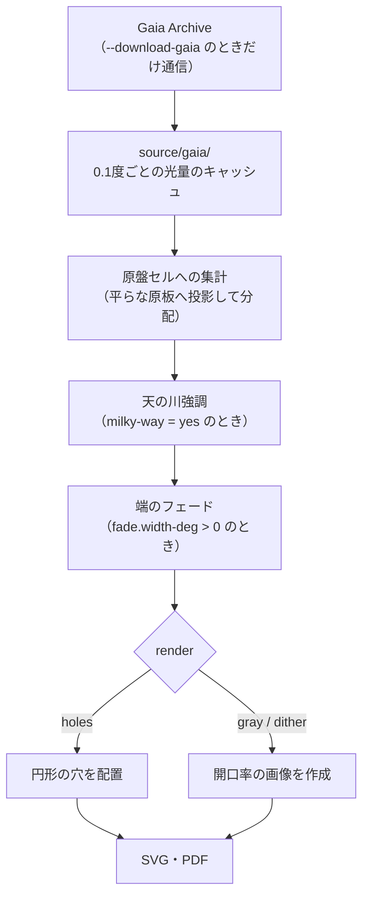

# 全体の構成

GingaForgeの全体像をまとめます。インストールと基本の使い方は [README](../README.md)、
光量の計算や描き方の詳細と設定の一覧は [gaia.md](gaia.md) を参照してください。

## 処理の流れ

どちらのコマンドも同じ処理を通ります。違うのは設定ファイルの値です。



| 段階 | 内容 | 主な処理 |
|---|---|---|
| 取得 | Gaia DR3の全天体を空の区画ごとに集計して保存する | `gaia_catalog.download_gaia` |
| 読み込み | キャッシュの条件とチェックサムを確かめて読む | `gaia_catalog.iter_flux_bins` |
| 集計 | 空の区画の光量を、原盤上のセルごとの必要な開口面積にする | `EtchingBuilder.add_bin` |
| 強調 | 背景に相当する明るさを差し引く | `EtchingBuilder._enhance_milky_way` |
| フェード | 銀経320度・120度へ向けて光量を0にする | `EtchingBuilder._faded`、`fade_gain` |
| 描画 | 開口面積を穴または画像にする | `EtchingBuilder.build` / `build_raster` |
| 書き出し | 用紙に配置してSVG・PDFにする | `plate_writer` |

既存の原盤は、読み込みから描画までが成功した後で上書きします。途中で失敗しても前回の原盤は残ります。

### 用語

| 用語 | 意味 |
|---|---|
| 原盤（原板） | 投影機に入れる1枚分の円形の版。N0・N1・S0・S1の4枚で担当領域を覆う |
| 集計ビン | Gaiaの光量を合計する空の区画（同梱設定は銀経・銀緯0.1度） |
| セル | 原盤上で光量をまとめる正方形の区画（`cell-size-mm`） |
| 開口面積 | 光を通す面積。投影の明るさはこの面積に比例するものとして扱う |
| 開口率 | セルの必要な開口面積 ÷ セルの面積 |
| 列 | 用紙を横に等分した区画。`plate.select` の原盤を上から並べる。列ごとに設定を変えて比べられる（`column.count`） |

## 方式とコマンド

| コマンド | 用途 | 設定ファイル | 出力（同梱設定） |
|---|---|---|---|
| `gaia-etch` | 金属エッチング | `gaia-etch.properties` | `output/gaia-etch/inverted/gaia-etch-*.svg`・`.pdf` |
| `gaia-ohp` | OHPフィルム印刷 | `gaia-ohp.properties` | `output/gaia-ohp/inverted/gaia-ohp-*.svg`・`.pdf` |

`gingaforge gaia-ohp` は `gingaforge gaia-etch -f gaia-ohp.properties` と同じです。
`gingaforge` コマンドは `python -m gingaforge` でも実行できます。

同梱の設定の主な違いは次のとおりです。

| 設定 | `gaia-etch` | `gaia-ohp` |
|---|---:|---:|
| 描き方 `render` | holes（円形の穴） | gray（階調） |
| 集計セル `cell-size-mm` | 0.4 mm | 0.056 mm |
| 光量倍率 `flux-gain` | 0.05 | 0.4 |
| 天の川強調 `milky-way` | no | yes |
| 端のフェード `fade.width-deg` | なし | 15度 |
| 原板の距離 `plate-distance` | 50 mm | 400 mm |
| レンズの焦点距離 `focal-length` | 19 mm | 30 mm |
| 原盤枠の直径 `plate.frame-diameter` | 138.5 mm（自動計算） | 50 mm |
| 用紙 | 2枚（1枚に1原盤） | 1枚（2原盤 × 3列 × 2行の計12枚） |

### オプション

| オプション | 内容 |
|---|---|
| `-f <設定ファイル>` | 別の設定ファイルを使う（相対パスは実行時のフォルダが基準） |
| `-svg` / `-pdf` | SVGのみ / PDFのみ出力。省略時は両方 |
| `-mirrored` | SVG・PDFを出力し、PDFの2ページ目に裏面印刷用の左右反転を追加 |
| `--download-gaia` | Gaiaの光量を取得してから生成 |

`-svg`・`-pdf`・`-mirrored` は同時に指定できません。一覧は `gingaforge <コマンド> --help` で表示します。

`--download-gaia` が必要なのは、初回と `galaxy.gaia.*` の等級・集計幅を変えたときです。
寸法・明るさ・描き方だけを変えたときは再取得しません。通常の実行は通信しません。

## 担当領域

銀緯 −20度以上 +20度以下を次の4枚の原盤に分けます。
領域の定義は `src/gingaforge/galaxy_geometry.py` の `REGIONS` にまとめています。

| 原盤 | 銀経の範囲 | 中心銀経 |
|---|---|---|
| S1 | 320度以上360度未満 | 340度 |
| S0 | 0度以上40度未満 | 20度 |
| N0 | 40度以上80度未満 | 60度 |
| N1 | 80度以上120度未満 | 100度 |

空では上の表の順につながり、銀経320度から0度を通って120度までの160度分を担当します。

- 銀経は0度以上360度未満に正規化し、各区間は下端を含み上端を含みません（境界上の星が重複しないため）。
- 銀経120度以上320度未満、および銀緯±20度の外は対象外です。
- N/Sは原盤の名前の一部で、赤緯・銀緯の正負を意味しません。
- 中心配置の投影機に加えて、偏心投影機（`projector-horizontal`・`projector-vertical`）にも対応します。投影の計算は [gaia.md](gaia.md#投影) を参照してください。
- 恒星原盤は別プロジェクトの [OTL](https://github.com/asanumakottii-collab/Orb-Transform-Library) が担当します。

## 用紙の配置

用紙はA4縦です。用紙を `column.count` 列に等分し、各列に `plate.select` の原盤を、書いた順に上から1枚ずつ並べます。

| 設定 | 意味 | 省略時 |
|---|---|---|
| `plate.select` | 作る原盤と、上からの並び順 | 全原盤を空でつながる順（N1, N0, S0, S1） |
| `plate.repeat` | その並びを1列の中で何回繰り返すか（2回目以降はコピー） | 1 |
| `plate.per-column` | 1列に並べる枚数。超えた分は次の用紙へ | 全部を1用紙に |
| `column.count` | 列の数。列ごとに設定を変えられる | 1 |
| `plate.frame-diameter` | 原盤の直径（mm） | 上限 − 10 mm |

1枚の大きさの上限は、横が 210 mm ÷ `column.count`、縦が 297 mm ÷ 1列の枚数（`plate.per-column`、省略時は選んだ数 × `plate.repeat`）です。

同梱の `gaia-etch` は1列に N1・N0 の2枚、`gaia-ohp` は3列に N1・N0・S0 の3枚ずつを、それぞれ1用紙に並べます。

```
 gaia-etch-0       gaia-ohp-0
+-----------+     +-----------------+
|    N1     |     | N1   | N1  | N1  |
|           |     |      |     |     |
|-----------|     | N0   | N0  | N0  |
|    N0     |     |      |     |     |
|           |     | S0   | S0  | S0  |
+-----------+     +-----------------+
                    #1     #2    #3
```

PDFは倍率100%・「用紙に合わせる」なしで印刷してください。詳しい決まりは
[原盤枠と用紙の配置](gaia.md#原盤枠と用紙の配置)、[列ごとに設定を変えて並べる](gaia.md#列ごとに設定を変えて並べる)、
[行で同じ原盤を並べる](gaia.md#行で同じ原盤を並べる)を参照してください。

## 出力先

出力先は設定では指定せず、**設定ファイルと同じフォルダの `output/<設定ファイル名>/`** に保存します。
さらに `color.invert` で `inverted/`（黒地に白）と `normal/`（白地に黒）に分けます。

```
output/
  gaia-etch/inverted/       gaia-etch.properties の出力（color.invert = yes）
  gaia-etch/normal/         gaia-etch.properties を color.invert = no で生成したもの
  gaia-ohp/inverted/        gaia-ohp.properties の出力（color.invert = yes）
```

ファイル名は `<設定ファイル名>-<用紙番号>.svg`・`.pdf` です。`-mirrored` でも別のファイルは作らず、同じPDFの2ページ目に左右反転を追加します。

設定ごとにフォルダが分かれるため、ある設定の生成が別の設定の原盤を上書きすることはありません。
既存の原盤を残したまま試す場合は、設定ファイルを同じフォルダに別名でコピーして指定します。

```sh
cp gaia-ohp.properties gaia-test.properties
.venv/bin/gingaforge gaia-etch -f gaia-test.properties    # output/gaia-test/ に出力
```

## 設定ファイル

設定は `.properties` ファイルに `キー = 値` の形で書きます。キーの一覧は [gaia.md の設定](gaia.md#設定)にあります。

- 文法はJavaのプロパティファイルに準じますが、扱うのは1行に1つの `キー = 値`（`キー : 値` も可）だけです。行の継続やエスケープは使えません。
- `#` または `!` で始まる行はコメントです。行の途中からのコメントは書けません（値の一部になります）。
- `galaxy.gaia.input` などの相対パスは、設定ファイルの所在フォルダが基準です。

## ライブラリとして使う

原盤は `gingaforge.gaia_etch.generate` でも生成できます。戻り値は出力フォルダです。

```python
from gingaforge.gaia_etch import generate

generate("gaia-ohp.properties", formats=("svg", "pdf-mirrored"))
```

`formats` には `"svg"`・`"pdf"`・`"pdf-mirrored"` を指定します。`"pdf-mirrored"` は `"pdf"` と同じファイルに2ページ目を加えるものなので、`"pdf"` と一緒には指定しません。
`download=True` で `--download-gaia` と同じ動作になります。

## コードの構成

```
pyproject.toml             パッケージ定義（gingaforge コマンド）
gaia-etch.properties       金属エッチング用の設定
gaia-ohp.properties        OHPフィルム印刷用の設定
src/gingaforge/            ライブラリ本体
source/gaia/               Gaiaのキャッシュ（gitの対象外）
output/                    生成物
tests/                     テスト
docs/                      ドキュメント
```

| モジュール（`src/gingaforge/`） | 役割 | 主なもの |
|---|---|---|
| `cli.py` | 共通コマンド `gingaforge` | `main` |
| `gaia_etch.py` | 設定の検査、原盤の選択、列・行の展開、生成全体の進行 | `generate`、`main` |
| `gaia_catalog.py` | Gaia DR3の光量の取得、キャッシュの検証・読み込み | `GaiaSettings`、`download_gaia`、`iter_flux_bins` |
| `galaxy_geometry.py` | 担当領域、レンズの公式、投影・逆投影 | `REGIONS`、`GalaxyTransformer` |
| `galaxy_etching.py` | セルへの集計、天の川強調、端のフェード、穴の配置、画像の作成 | `EtchingSettings`、`EtchingBuilder`、`fade_gain`、`gray_pixels`、`dither_pixels` |
| `plate_writer.py` | 用紙の配置とSVG・PDFの書き出し（穴はベクトル、画像は画素） | `PlateWriterSVG`、`PlateWriterPDF` |
| `models.py` / `mathvector.py` | 天球・原盤上の座標、ICRSと銀河座標の変換、ベクトル演算 | `SpherePosition`、`PlatePosition`、`MathVector` |
| `config.py` | プロパティファイルの読み込み、出力先の決定 | `load_properties`、`output_directory` |

## テスト

```sh
.venv/bin/python -m unittest discover -v
```

| テスト（`tests/`） | 対象 |
|---|---|
| `test_galaxy_transformer.py` | 座標変換、投影と逆投影、原盤の書き出し |
| `test_gaia_etching.py` | 集計、天の川強調、端のフェード、穴と画像の作成、列と行の配置、原盤の選択、Gaiaキャッシュ、コマンド、同梱の設定 |
| `test_integration.py` | 別プロセスで実行したコマンド（設定ファイル基準の入出力、`--help`、不正なオプション） |
